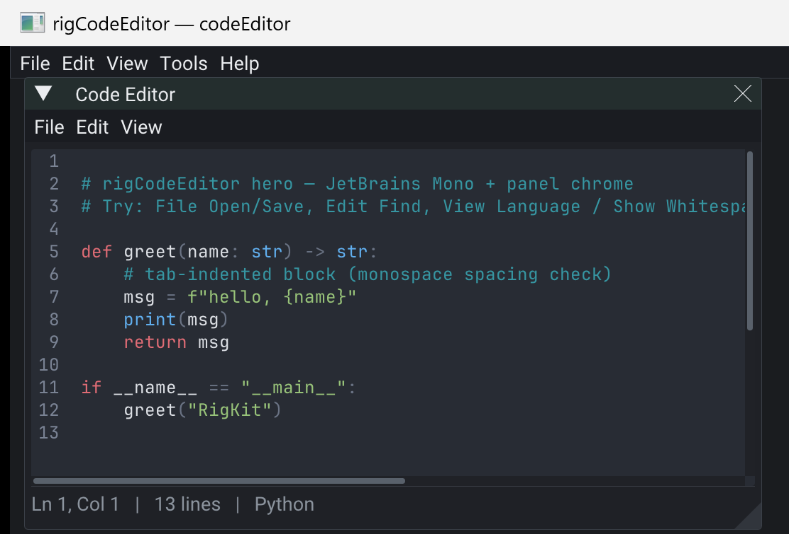

# rigCodeEditor





Shared **ImGui code editor** for RigKit tool apps - `*Editor` over [rigComponent](https://github.com/rigkid/rigComponent) `CCode` (same family as rigNodeEditor).

Every `CCode` entity becomes a Sublime-style tab; edits write back to the component. Apps can also seed the window with `getText` / `setText` (the hero does). Depends on **rigImGui** (`IMui` / `MWindow` / file dialogs / font atlas hooks).

## Features

- **TextEditor** (ImGuiColorTextEdit) + language definitions (including AFDKO `fea` for `CCode::language`)
- Panel chrome: File / Edit / View menus, find & replace (regex), open-file tabs
- Mirrors `CCode` buffers (+ optional `CAssetRef` path) and Properties light-edit
- **JetBrains Mono** Regular via `Mui::registerFontAtlasHook`
- Host dialogs through `IMui` (`std::vector<std::string>` extension filters)
- Files dropped on the window open as tabs (directories are refused). The file dialog keeps a drop while it is open
- CSV / TSV highlighting (delimiters, numbers, quoted fields, alternating columns)

## Use

```cpp
rigkit::rigCodeEditor::Options opts;
opts.windowVisible = true; // false if the app shows the window later
opts.fontSize = 14.f;
packs->registerPack(std::make_shared<rigkit::rigCodeEditor>(opts));
// after setupAll. The window manager lives on Mui, not IMui.
auto* mui = dynamic_cast<rigkit::Mui*>(engine->getUiManager());
auto ed = mui->getWindowManager()->getWindow<rigkit::CodeEditorWindow>("Code Editor");
ed->setText(src, TextEditor::LanguageDefinitionId::Python);
ed->panel().showFind(true);
```

## Example

[examples/codeEditor](examples/codeEditor/) - dockable Code Editor with JetBrains Mono and a seeded Python sample.

```bash
cmake -S examples/codeEditor -B examples/codeEditor/build
cmake --build examples/codeEditor/build --target codeEditor
```

## Pi note

JetBrains embedded Regular (~270KB) + TextEditor are desktop-tool weight - fine for author
apps. Keep the pack opt-in via `app.json` for lean install binaries.

## License

Pack MIT. TextEditor: ImGuiColorTextEdit (MIT). JetBrains Mono: SIL OFL
(`third_party/fonts/OFL.txt`).

## Style

Format first-party `src/` and `examples/` with clang-format before commit (never `third_party/`).

```bash
./tools/format.sh
./tools/install-hooks.sh    # once per clone - pre-commit formats staged C/C++
```

Hooks only look for `clang-format` on PATH and warn, without formatting, when it is missing. Put it on PATH:

- **Windows:** install [LLVM](https://github.com/llvm/llvm-project/releases) (enable "Add LLVM to the system PATH"), or `winget install LLVM.LLVM`, then open a new shell. Confirm: `clang-format --version`.
- **macOS:** `brew install clang-format`
- **Linux:** `sudo apt install clang-format`

From a RigKit host checkout, `./tools/install-hooks.sh` wires every pack repo. Full policy: [RigKit packs Style](https://github.com/rigkid/RigKit/blob/main/packs/README.md#style).

[API/docs](https://rigkid.github.io/rigCodeEditor/)
